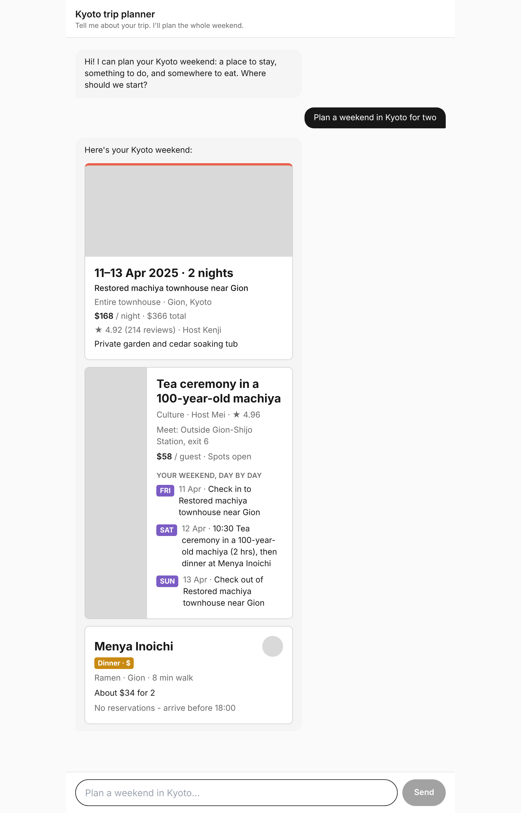
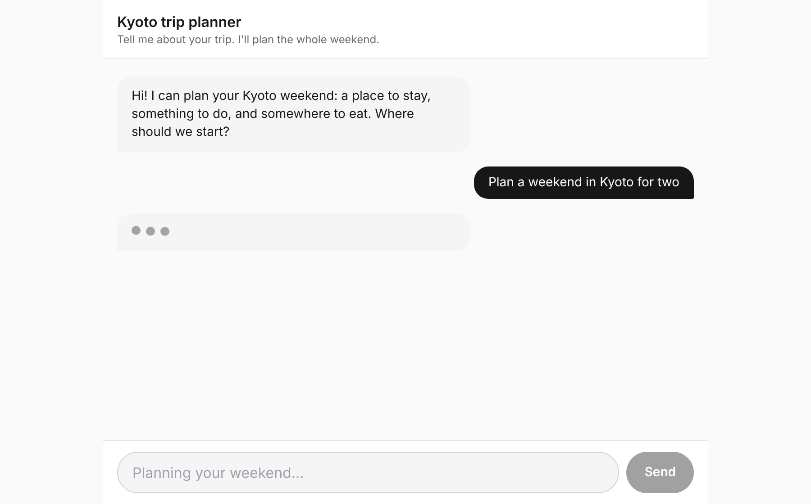
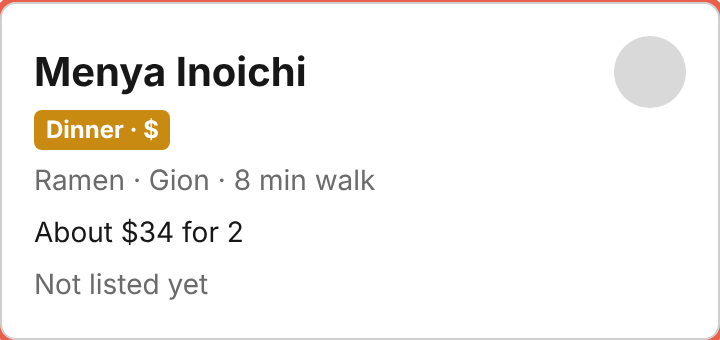

# Kyoto Trip Planner Chat

**Live link:** https://kyoto-trip-planner-psi.vercel.app (no login, opens straight into the chat on phone and laptop)

A happy-path prototype of the Kyoto trip-planner chat. Send any message: the input locks, pulsing dots play for about 2 seconds, then the chat shows a stay, an Experience and a food card, in that order.

## How to run

Run `npm install && npm run dev`, then open http://localhost:3000

## Pass checklist

Tested on the live link: phone (390px wide) and laptop (1280px wide).

| Check | Phone | Laptop |
|---|---|---|
| Link opens straight into the chat, no login | ✅ | ✅ |
| Sending a message locks the input ("Planning your weekend…") | ✅ | ✅ |
| Pulsing dots show in the reply bubble for about 2 seconds | ✅ | ✅ |
| Three different trip requests each show stay, Experience, food, in that order | ✅ | ✅ |
| Each card has its own image spot, biggest text and accent colour | ✅ | ✅ |
| An emptied field shows "Not listed yet", never a blank or "undefined" | ✅ | ✅ |
| No sideways scrolling, nothing cut off | ✅ | ✅ |

## The three cards

| Card | Image spot | Biggest text | Accent colour |
|---|---|---|---|
| Stay (`components/StayCard.tsx`) | Full-width grey banner on top | Travel dates: "11–13 Apr 2025 · 2 nights" | Coral top border |
| Experience (`components/ExperienceCard.tsx`) | Tall grey strip on the left | Title: "Tea ceremony in a 100-year-old machiya" | Purple FRI / SAT / SUN labels on a day-by-day plan |
| Food (`components/FoodCard.tsx`) | Small round grey thumbnail, top right | Place name: "Menya Inoichi" | Amber "Dinner · $" label |

## Screenshots

**1. Thread with all three cards** (stay, Experience, food, in that order)

**2. Thinking state:** input greyed out ("Planning your weekend…") and three pulsing dots in the reply bubble

**3. Filler line:** the food card with its booking note emptied shows "Not listed yet"

## What's inside

- `data/mockResponse.json`: the mock response. Three items, one row copied from each sheet of the Kyoto Weekend Prototype Content Pack (Stays S1, Experiences E1, Food F1). Each item has a `cardType` and its `details`.
- `components/fill.ts`: any empty field shows the short filler line "Not listed yet".
- `components/ThinkingDots.tsx`: the pulsing dots. The 2-second delay is `THINKING_MS` in `data/mockResponse.ts`.
- `app/page.tsx`: the chat page (Next.js + Tailwind CSS). The input is disabled while the reply is loading.

Error handling (error bubble, Try again, forced failure) comes in the next stage.
